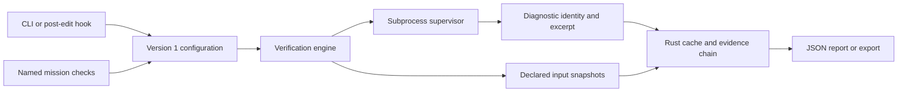
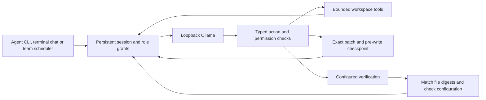

# Architecture

## Native verification

`loopsieve-cli` accepts trusted check and mission input. `loopsieve-core` selects commands, captures bounded output, computes failure transitions, and commits results to locked, atomically replaced state. Rust evidence stays separate from Python session data.



See the [migration guide](MIGRATION.md) for native commands and data boundaries.

## Native agent runtime



Each agent turn claims its session using a file lock. The runtime persists a pending checkpoint before applying a patch. If a process stops at that point, recovery blocks further automatic action and leaves the checkpoint available for review. Legacy SQLite migration opens the source in read-only mode and copies selected observations and edited paths into a fresh session with current permissions.

## Python agent architecture

```text
CLI / TUI / Claude Code hook
          |
          v
Capability registry + router + permission engine
          |
          v
ModelTeam (<=15 model slots) ---- TeamStore / dialogue
          |
          v
Logical agents (<=100 per model) -- role manifests
          |
          v
AgentRuntime (bounded JSON actions)
          |
          +--> workspace inspect / tool / search / diff
          +--> exact-match patch + checkpoint
          +--> configured verification
          +--> finish / blocked / restore
          |
          v
SQLite Journal + evidence ledger + artifact store
          |
          v
Generated artifacts, handoff manifest, release gate
```

The terminal is the primary product surface. Studio/WebUI modules remain in the
tree for compatibility but are not the recommended interface. The Claude Code
integration uses official project hooks and does not impersonate or copy Claude
Code internals.

The runtime does not use 1,500 model processes. One provider slot serves its
logical agents through a queue; inactive agents consume no model weights.
