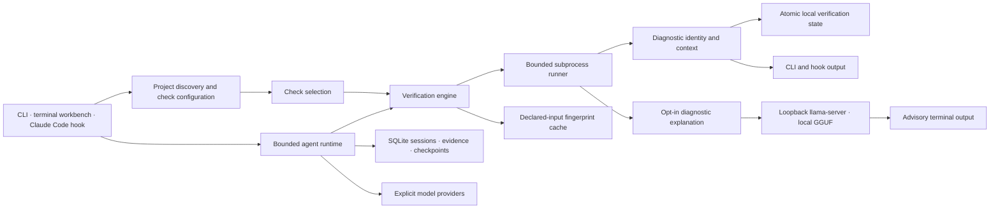

# Architecture

LoopSieve 0.6 is a Python package with a terminal workbench, Claude Code hooks, an optional read-only localhost web surface, a verification engine, and a bounded agent runtime. The bundled HTML/JavaScript and glTF are static Studio assets. JSON holds catalogs, check configuration and fixtures. TOML defines Python packaging, and YAML configures GitHub Actions. Python's standard library provides process, HTTP, JSON and SQLite support. Textual is optional.

| Area | Modules | Responsibility |
|---|---|---|
| Entry points | `cli.py`, `hook.py`, `commands.py`, `tui.py`, `webui.py`, `studio.py` | Command routing, local interfaces and optional hook context |
| Verification | `project.py`, `config.py`, `planner.py`, `engine.py`, `runner.py` | Detect or select checks, run subprocesses and record observed results |
| Reuse and diagnostic identity | `verification_state.py`, `diagnostics.py`, `state.py` | Input fingerprints, source-aware failure identity and per-project JSON state |
| Agent and evidence | `agent_runtime.py`, `permissions.py`, `orchestrator.py`, `model_team.py`, `provenance.py` | Bounded decisions, explicit permissions, SQLite sessions and evidence |
| Catalogs and providers | `catalog.py`, `capability.py`, `providers.py`, `provider_health.py`, `model_manager.py`, `huggingface.py` | Registry lookup, optional backends, metadata and model distribution |
| Experimental diagnostics | `local_llm.py`, `tools/run_local_model.py` | Bounded excerpts and streamed local explanatory text |

Verification is the source of truth. Positive cache reuse requires deterministic behavior and an explicit complete input declaration. The cache fingerprint covers the declared input files, changed files, relevant manifests, selected environment variables, check settings and the executable identity. Checks with undeclared time, network or filesystem inputs need fresh execution. On a cache miss, the engine compares input fingerprints before and after a successful check. Only matching snapshots create a reusable result.

Diagnostic identities incorporate parsed locations, multiplicity, and related lines. Well-formed in-workspace Python source can resolve an enclosing symbol and statement ordinal. External paths and unresolved source use exact locations. Each Python source is parsed at most once per fingerprint computation. State updates read the latest JSON, merge the current run and replace the file atomically under an OS lock. Checks run outside the lock. If saving fails, verification still returns the observed result and emits a state warning.

The LLM integration follows verification. A local client sends the tool label, status, exit code and diagnostic excerpt to a loopback llama.cpp server. Its advice never enters the permission engine, checkpoint system, or check status computation. The agent runtime has a separate provider contract for bounded JSON decisions. See [model integration](llm-integration.md).

## Project philosophy

Prefer observed check outcomes over generated confidence. Reuse verification only when declared evidence covers the decision. Keep diagnostics actionable and preserve the status when reducing repeated output. Keep check execution, model inference and effectful agent actions at explicit boundaries.
